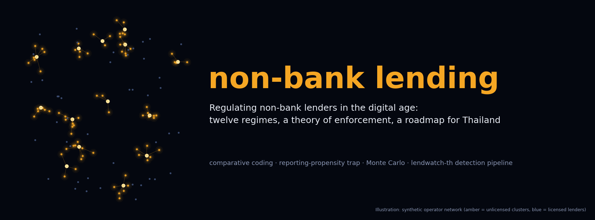
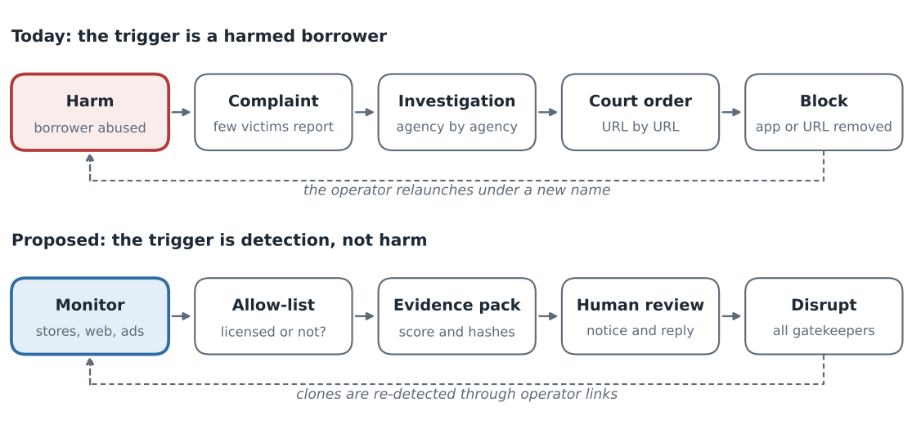
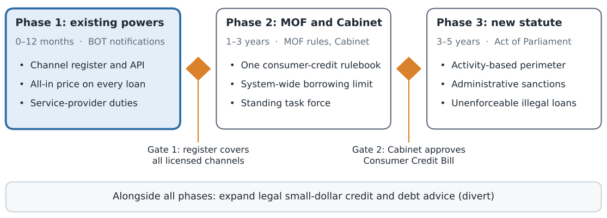

<p align="center"><a href="paper/paper.pdf"></a></p>

<p align="center">
<a href="analysis/requirements.txt"></a>
<a href="https://thanatchon36.github.io/non-bank-lending-research/paper/"></a>
<a href="paper/paper.pdf"></a>
<a href="paper/paper.tex"></a>
<a href="lendwatch-th/tests"></a>
<a href="#important-caveats"></a>
<a href="https://zenodo.org/badge/latestdoi/1456110651"></a>
<a href="https://huggingface.co/datasets/thanatchon36/non-bank-lending-research"></a>
<a href="https://huggingface.co/thanatchon36/lendwatch-th"></a>
<a href="#license"></a>
</p>

<p align="center">
📖 <b><a href="https://thanatchon36.github.io/non-bank-lending-research/paper/">Read the paper online</a></b> ·
📄 <b><a href="paper/paper.pdf">Download the PDF</a></b> ·
🔍 <b><a href="lendwatch-th/">lendwatch-th</a></b> ·
📊 <b><a href="paper/figs/">Figures</a></b> ·
🤗 <b><a href="https://huggingface.co/datasets/thanatchon36/non-bank-lending-research">Dataset</a></b> ·
🧮 <b><a href="https://huggingface.co/thanatchon36/lendwatch-th">Model</a></b>
</p>

**A comparative study of how twelve regimes regulate non-bank consumer lenders, a theory of
complaint-driven enforcement against unlicensed lenders, and a three-phase reform roadmap for
Thailand.** The repository holds the paper, the code that produces every figure and number in
it, and `lendwatch-th`, an open-source pipeline for detecting unlicensed digital lenders.



> **Simulated data notice.** Model results, the Monte Carlo and the pipeline validation use
> synthetic data and hypothetical parameters. They illustrate mechanisms and are not estimates
> for the Thai market. Institutional facts (laws, dates, rate ceilings) were compiled from
> secondary knowledge and must be checked against primary sources before citing.

## Install and quickstart

Python 3.10+ and a TeX Live installation with `pdflatex`.

```bash
pip install -r analysis/requirements.txt

python analysis/sim.py                 # Monte Carlo and model results -> analysis/data/
python analysis/validate_lendwatch.py  # 30 synthetic markets, about 1 minute -> analysis/data/
python analysis/figures.py             # all figures -> paper/figs/

cd paper && pdflatex paper.tex && pdflatex paper.tex   # twice, for cross-references

cd ../lendwatch-th && python -m pytest -q              # 28 pipeline tests
python -m lendwatch demo --out outputs_demo            # full pipeline on a synthetic market
```

The simulation uses a fixed random seed, so results match the paper exactly.

| Script | Purpose |
|---|---|
| `analysis/sim.py` | Monte Carlo and model results → `analysis/data/sim_summary.json` |
| `analysis/validate_lendwatch.py` | Pipeline validation on 30 synthetic markets → `analysis/data/lendwatch_validation.json` |
| `analysis/figures.py` | All ten figures, vector PDF and PNG → `paper/figs/` |
| `python -m lendwatch demo` | Offline end-to-end run on an invented market with known ground truth |
| `python -m lendwatch collect` | Collect public listings (Google Play, App Store, web); needs network |
| `python -m lendwatch analyse` | Score and link collected artefacts against the licensed-lender allow-list |

## What `lendwatch-th` does

1. **Collectors** (`lendwatch/collectors.py`): public lending-app and website listings from app
   stores and the web, stored as artefacts with source and capture time.
2. **Allow-list matching** (`lendwatch/registry.py`): checks each artefact against the licensed
   lenders published by the Bank of Thailand and the Fiscal Policy Office
   (`data/licensed_registry_template.csv`).
3. **Rate parsing** (`lendwatch/rates.py`): extracts interest and fee terms from Thai and English
   text and compares them with the legal ceilings.
4. **Operator linkage** (`lendwatch/linkage.py`): links apps, sites, LINE IDs, phones and bank
   accounts to the operators behind them.
5. **Risk scoring** (`lendwatch/scoring.py`): ranks operators into review tiers. A score is a
   queue position for a human reviewer, never a finding of illegality.
6. **Population estimate** (`lendwatch/mse.py`): multiple systems estimation of how many
   operators no data source sees, with log-linear model averaging.
7. **Evidence integrity** (`lendwatch/evidence.py`): hashed, salted case files ready for review
   (see `sample_output/`).

## Research: *Regulating Non-Bank Lenders in the Digital Age*

The working paper by Thanatchon Chongmankhong (November 2026) is in [`paper/`](paper/): a PDF in
[`paper/paper.pdf`](paper/paper.pdf) and its source in [`paper/paper.tex`](paper/paper.tex). It codes
twelve regulatory regimes, places Thailand among them, develops a theory of why complaint-driven
enforcement under-detects unlicensed lenders (the reporting-propensity trap), illustrates it with
simulations, and proposes a three-phase roadmap.

- Read online: <https://thanatchon36.github.io/non-bank-lending-research/paper/> (web version built with pandoc in `docs/paper/`)
- Figures: [`paper/figs/`](paper/figs/) · Numerical results: [`analysis/data/`](analysis/data/)
- Dataset on Hugging Face: [`thanatchon36/non-bank-lending-research`](https://huggingface.co/datasets/thanatchon36/non-bank-lending-research), with the simulation summary, pipeline validation and a sample `lendwatch-th` run (all synthetic)
- Model card on Hugging Face: [`thanatchon36/lendwatch-th`](https://huggingface.co/thanatchon36/lendwatch-th), with the rule-score specification. It holds no trained weights, because the scorer is an uncalibrated rule score
- Sections: background on Thailand's non-bank credit market, comparative evidence, theory of
  enforcement, quantitative illustrations, roadmap, research agenda; appendices with proofs,
  codebook and simulation details

<p align="center"></p>

## Repository layout

```
paper/
  paper.tex                 LaTeX source
  paper.pdf                 compiled paper
  figs/                     fig1–fig10, vector PDF + PNG
analysis/
  sim.py                    Monte Carlo and model results
  validate_lendwatch.py     validation on 30 synthetic markets
  figures.py                all figures
  data/                     sim_summary.json, lendwatch_validation.json
lendwatch-th/
  lendwatch/                collectors, registry, rates, linkage, features,
                            scoring, mse, evidence, pipeline, cli, demo
  data/                     licensed_registry_template.csv
  sample_output/            watchlist, operators, MSE estimate, case files
  tests/                    rates, text and registry, MSE, pipeline demo
```

## Important caveats

- **Institutional facts need verification.** Laws, dates, rate ceilings and references were
  compiled from secondary knowledge without access to primary databases. The coding of the
  twelve regimes is provisional and has not yet been validated by local experts.
- **All quantitative results are simulated.** They illustrate mechanisms, not the Thai market.
- **The live collectors in `lendwatch-th` have not been run against real app stores.** Check
  platform terms of service before collecting, and treat every risk score as a queue position
  for human review, never a finding of illegality.
- **Preparation.** Drafting, simulations and figures were prepared with the assistance of an
  AI system (Claude, Anthropic); the author takes responsibility for the content.

## Citation

See [`CITATION.cff`](CITATION.cff); each release is archived on Zenodo (DOI badge above).

```bibtex
@misc{chongmankhong2026nonbank,
  author = {Chongmankhong, Thanatchon},
  title  = {Regulating Non-Bank Lenders in the Digital Age: A Comparative Study of Twelve
            Regimes, a Theory of Complaint-Driven Enforcement, and a Roadmap for Thailand},
  year   = {2026},
  note   = {Working paper}
}
```

## License

No license has been chosen yet. Until one is added, others may view the repository but have
no right to reuse the code or text.
